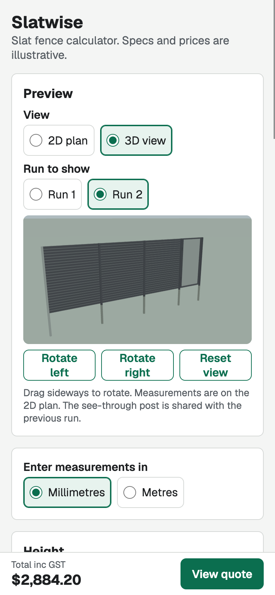
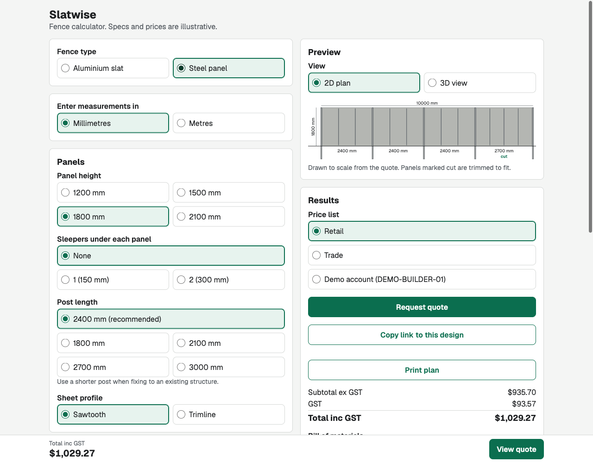
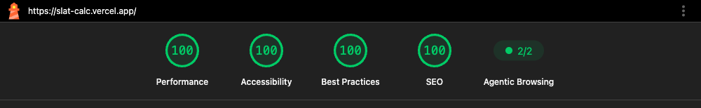

# Slatwise: fence calculator

[](https://github.com/jasonmitchellwebdeveloper/slat-calc/actions/workflows/ci.yml)

**Live demo: [slat-calc.vercel.app](https://slat-calc.vercel.app)**

A mobile-first calculator for two fence types, aluminium slat and Colorbond-style steel panel. Enter your fence runs and it returns a to-scale drawing, an exact bill of materials, a cut list, retail, trade or contract pricing, and a validated quote payload ready to hand to an ERP. Both products run through the same engine pipeline, UI, price lists, quote API and share links.

Specs and prices are illustrative. This is a portfolio project, not affiliated with any supplier.

<p>
  
  
</p>

## Features

- **Two products behind one switch:** slat fencing, solved from a target height, and steel panel fencing, built from fixed panel sizes.
- **Height solver:** turns a target height into the three closest builds that can actually be made from whole slats.
- **Steel panel rules:** panel heights, sleepers, post lengths, sheet profiles and concrete, with one long or cut panel taking up whatever a run leaves over.
- **Run builder:** multiple runs, shared corner posts, a gate at the end of a run, and in-ground or base-plate mounting. Enter measurements in millimetres or metres.
- **Live drawing:** a to-scale SVG elevation, built from the same layout data as the bill of materials so the two can't disagree.
- **Optional 3D view:** a three.js model of the selected run, derived from the same geometry, that you can rotate by drag or with buttons. It's downloaded only when someone opens it.
- **Cut optimiser:** packs every cut into 5800 mm stock lengths, and reports lengths to order, waste and the cut pattern for each.
- **Tiered pricing:** an account contract price wins over the trade tier, which wins over retail.
- **Quote API:** a typed payload validated in the browser and again on the server, which also recalculates the prices so a tampered request is rejected.
- **Share and print:** the design lives in the URL, so a link reopens it exactly. A print view gives a plan with every run, the materials and the cuts.

## Architecture

```
src/
  engine/       Pure TypeScript: height, BOM, cutting, pricing, quote. No React.
  lib/          UI state and helpers: reducer, URL encoding, validation, formatting.
  components/   Thin React UI, one folder per component, styled with SCSS modules.
  app/          Next.js page and the POST /api/quote route.
e2e/            Playwright: the reference run, axe scans, keyboard-only flow.
```

The important boundary is the engine. Its only dependency is Zod, for the quote and link schemas, and it knows nothing about React, Next.js or the page. Every number on screen comes from one call to `calculate()`. So the UI is replaceable and the logic can move: it could ship as an embedded widget or web component in a storefront that can't run Next.js, with the quote going through whatever API that platform exposes.

Other deliberate choices:

- **Integer millimetres and integer cents throughout**, so there's no floating-point drift. Metres are only an input convenience, converted digit by digit.
- **GST rounded once on the subtotal**, because rounding per line drifts on large orders.
- **Only the design is stored in state.** Everything else is derived, so a figure can't go stale.
- **A shared link is untrusted input.** It's size-capped, schema-checked and run through the engine, and a bad one falls back to the starting design with a notice.
- **The page is statically prerendered.** Only `/api/quote` runs on the server.
- **SVG for the plan, WebGL for 3D.** SVG is prerendered, prints sharply and suits a dimensioned drawing. three.js adds about 135 KB gzipped, so it's lazy-loaded and normal visits never pay for it. It renders only when something changes, with no animation loop.
- **Slat gaps are a mipmapped texture in 3D.** Drawn as geometry, gaps thinner than a pixel alias into speckle. A texture averages them into a smooth tone while wide gaps still show as lines.

## How the numbers work

**Height.** A build is a slat count `n` and a gap, using a 65 mm slat face and 50 mm ground clearance:

```
panel height = 65 × n + gap × (n − 1)
fence height = panel height + 50
```

The solver tries the slat counts either side of the target for each gap (5, 9 and 20 mm) and returns the three closest.

**Bays.** With a 1930 mm maximum bay and 50 mm posts:

```
bays      = ceil(run length / 1930)
bay width = floor(run length / bays)
slat cut  = bay width − 50 − (2 × 2 mm channel clearance)
posts     = bays + 1, minus 1 if sharing a corner, plus 1 for a gate
```

Bay width is floored to whole millimetres so every slat in a run matches. Any leftover is taken up on site.

**Cuts.** First-fit decreasing: sort the cuts longest first, then put each one in the first stock length with room, opening a new length when none has it. Each cut allows 3 mm for the saw. It isn't guaranteed optimal, but it's fast, predictable and close on this kind of repeated-length job.

**Steel panels.** A run fills with 2400 mm panels, after 100 mm for its two ends:

```
usable = run length − 100
whole  = floor(usable / 2400)
rest   = usable − whole × 2400

rest = 0      whole standard panels, 3 sheets each
rest ≤ 780    one panel becomes a long one (3180 mm rail), cut to fit
otherwise     one extra short panel, cut to fit, sheets = ceil(rest / 800)
```

Each panel takes 2 channel posts, 2 rails and 12 screws. Each run takes 2 steel end posts, and a gate adds 2 more. Concrete is 1.5 bags per post hole, rounded up. These rules were worked out from a published calculator's output, and the tests check 25 lengths and one gate against what it returned. They reproduce those quantities rather than claiming to be its actual logic.

**Worked example, slat.** 6000 mm run, 1800 mm target, 5 mm gap, in-ground, retail:

| Step          | Result                                                   |
| ------------- | -------------------------------------------------------- |
| Closest build | 25 slats, 1745 mm panel, 1795 mm fence                   |
| Bays          | 4 at 1500 mm, so 1446 mm slat cuts and 5 posts           |
| Slat cuts     | 4 bays × 25 slats = 100 cuts                             |
| Stock lengths | 25, each cut 4 × 1446 mm with a 4 mm offcut (0.1% waste) |
| Total         | $1,383.50 ex GST + $138.35 GST = **$1,521.85**           |

## Integration notes

`POST /api/quote` is the integration story in miniature, with a marked point where a real connection would go. On a store such as commercebuild with Sage behind it, the concepts map like this:

| Calculator concept | ERP / platform equivalent                             |
| ------------------ | ----------------------------------------------------- |
| `sku`              | ERP item code                                         |
| `tier`             | Price list code                                       |
| `accountCode`      | ERP customer account ID                               |
| `ACCOUNT_PRICES`   | Customer-specific price list                          |
| `POST /api/quote`  | Sales quote or cart via the platform API or a webhook |
| `catalogue.ts`     | Nightly product and price sync job                    |

## Quality

- **407 unit and API tests** (Vitest), with the engine written test-first against hand-worked numbers.
- **29 browser tests** (Playwright): reference runs for both products, axe across nine page states, keyboard-only quote requests, focus staying clear of the sticky bar, old share links, tampered quotes, and the 3D view's lazy loading, controls and fallbacks.
- **CI** runs formatting, lint, types and both test suites on every push.
- **Lighthouse mobile on production, three runs:** Performance 99 to 100, Accessibility, Best Practices and SEO 100. Largest Contentful Paint 0.8 to 1.4 s, Cumulative Layout Shift 0.



Built with AI-assisted development (Claude Code), as the commit history shows.

## Known limits

This is a demo, and these are the things a production version would need to address:

- **No accounts.** Anyone can choose the trade or demo account prices. The server checks a quote's prices are right for its price list, but not that the person is entitled to that list. A real integration would take the tier and account from the login session.
- **Contract prices reach the browser**, because the engine runs there. Real ones would need to stay on the server.
- **Nothing is stored or sent.** A quote reference is generated and returned, then forgotten.
- **Level ground and straight runs.** There's no stepping on slopes or raked panels, and gates only go at the end of a run.
- **Steel panels are standard infill only**, with single gates. Lattice-style panels, double gates and extras such as coloured caps are out. Sleeper size, and how a shared corner changes the posts, are assumptions rather than observed figures.
- **3D shows one run at a time**, because the design doesn't record which way a corner turns. It has no dimensions, which stay on the 2D plan, and a very long run looks small because zooming is off so the page can scroll.
- **Colour doesn't change SKUs or prices**, which a real catalogue would.
- **Waste counts offcuts only**, not the metal lost to the saw.
- **A shared link is read in the browser**, so it shows the starting design for a moment before swapping in. That keeps normal visits static and fast.

## What I'd do next

- Stepping and raked panels on slopes, for both fence types
- Double gates and more steel panel styles
- Live catalogue and price sync
- Stock availability and freight by postcode
- Gates anywhere in a run
- Analytics events for the calculator funnel

## Run it locally

Requires Node 22 (`nvm use` picks it up from `.nvmrc`).

```bash
npm ci
npm run dev                       # http://localhost:3000
npx vitest run                    # unit and API tests
npx playwright install chromium   # first time only
npm run test:e2e                  # browser tests
```

## Disclaimer

All specifications, SKUs and prices are illustrative and aren't any supplier's real catalogue. This project isn't affiliated with or endorsed by any supplier or platform named here.
